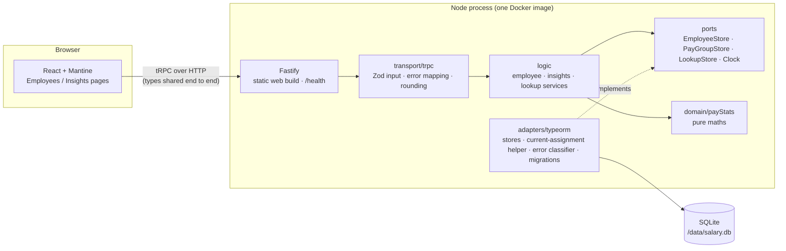
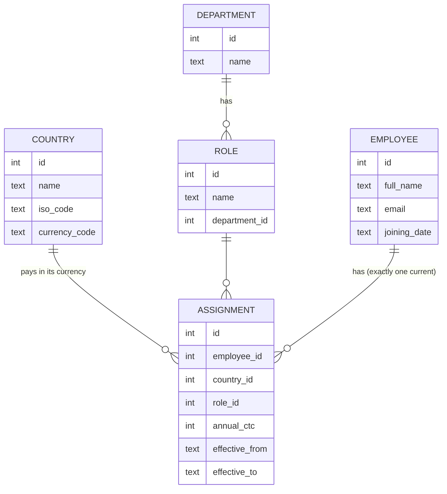
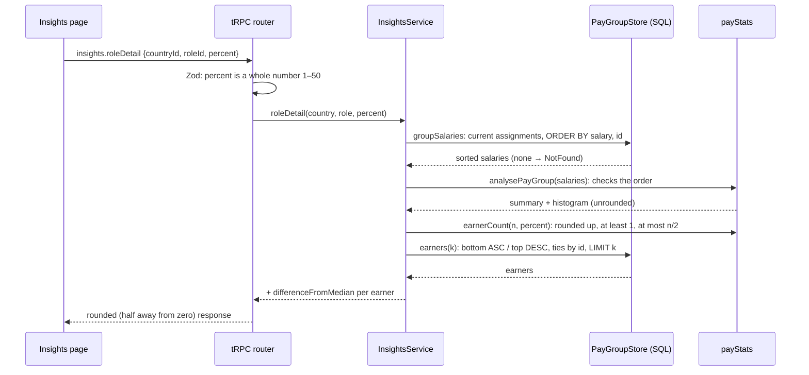

# Architecture

This is a one-page overview. The full schema, module interfaces and their invariants are in [design.md](design.md), and the reasoning behind each choice is in [decisions.md](decisions.md).

## Shape of the system

One process serves both the UI and the API. It ships as one Docker image, with SQLite on a mounted volume (D-001).

- **The business logic never imports TypeORM or the SQLite driver.** An ESLint rule enforces this. Switching to Postgres changes only `adapters/typeorm` (D-012).
- **The database sorts and filters; `payStats` calculates** (D-011). The one exception is the Insights table's column sorting, which happens in the browser because its columns are calculated (D-016).
- **One Zod schema per input**, in `packages/shared`, used by both the API and the React forms. The browser and the server always apply the same rules.

## Data model

- **An employee's identity is separate from their dated assignment** (D-010).
- The **current assignment** is the row with `effective_to IS NULL`. A partial unique index allows at most one per employee.
- In this MVP, edits change that row in place. Salary history would mean closing it and inserting a new one: a change to one write path, not a migration.

## A request end to end: role detail

## Performance

**Measured in-process** through the full router stack, against a database seeded with 10,000 employees. Each figure is the median of 50 runs after warm-up, on an Apple M4 Pro. HTTP and JSON overhead come on top.

| Operation | Median | p95 |
|---|---|---|
| Generate the 10k seed / write it (one transaction) | 34 ms / 33 ms | |
| `employees.list`: first page, 20 rows, by name | 2.9 ms | 3.3 ms |
| `employees.list`: page 400 of 500 (deep offset) | 8.3 ms | 8.6 ms |
| `employees.list`: search "an" (substring, full scan) | 4.3 ms | 5.1 ms |
| `employees.list`: India, sorted by salary | 2.3 ms | 2.3 ms |
| `insights.countryOverview`: India, about 4k salaries | 1.2 ms | 1.3 ms |
| `insights.roleDetail`: one pay group, 10% | 0.6 ms | 0.7 ms |

The database file is 1.8 MB, so it lives entirely in the page cache.

**What makes the insights queries fast:**
- The partial index `ix_assignment_pay_group (country_id, role_id, annual_ctc, employee_id) WHERE effective_to IS NULL` returns a country's salaries already in pay-group order.
- `EXPLAIN QUERY PLAN` confirmed an index search with **no sort step**. Ordering the id tie-break by `a.employee_id` (the index's last column) rather than `e.id` removed a temporary B-tree. That one change cut the overview from 1.6 to 1.2 ms.

**What's deliberately left unoptimised, and when to revisit it:**
- **Substring search scans the table.** A leading-wildcard `LIKE` can't use a B-tree index. At 10k rows that's 4 ms. Beyond about a million rows, the next step would be SQLite FTS5 trigram, or `pg_trgm` on Postgres.
- **Offset pagination.** Deep pages cost more (8 ms at page 400). Keyset pagination would fix that, but HR rarely pages that deep; search and filters are the realistic path.
- **The total count is a second query** with the same `WHERE`. That's simpler than a window function, which would stop SQLite from ending the page scan early.
- **One writer.** SQLite on one volume suits a single HR user (D-001). Several concurrent editors would mean Postgres, which only changes the adapter (D-012).
- **The web bundle** is 1.0 MB of JavaScript, 294 kB gzipped, mostly Recharts and Mantine. That's fine for an internal tool. Lazy-loading the Insights page would take the chart library off the first load.

## Testing

Tests sit at four agreed seams (design §6):
- **`payStats`**, tested directly with table-driven cases
- **the tRPC router**, via `createCaller` on a real in-memory SQLite database **built by running the migrations**
- **the migrated schema's constraints**
- **page-level React Testing Library tests**, with tRPC answered by a canned link

There are no in-memory fake stores: sorting and filtering are SQL, so a fake would test the wrong thing. `npm run check` runs typecheck, lint and all tests.
